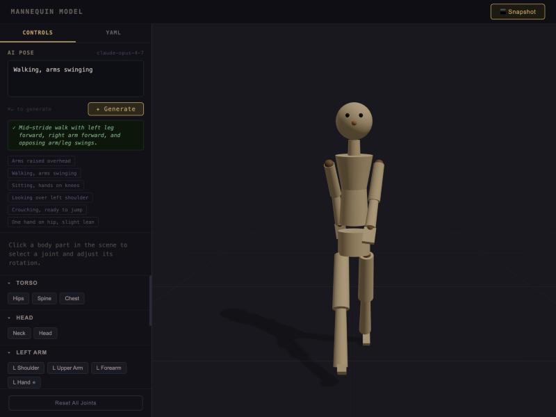

# Mannequin Model

A 3D artist's wooden mannequin in the browser. Describe a pose in plain text and Claude generates it — or dial in joints manually.



**Live demo:** https://sodaned.github.io/mannequin-model/

---

## Features

- **AI pose generation** — type a description ("walking, arms swinging") and Claude sets all 18 joints
- **Manual joint control** — click any body part in the scene or use the panel to adjust individual joints
- **Constrained rotations** — every joint has anatomically sensible min/max limits
- **YAML export** — switch to the YAML tab to copy the current pose as structured data
- **Snapshot** — download a PNG of the 3D view

## Stack

| Layer | Library |
|---|---|
| 3D rendering | Three.js via `@react-three/fiber` + `@react-three/drei` |
| UI | React 18 |
| State | Zustand |
| AI | Anthropic SDK (`claude-opus-4-7`) |
| Build | Vite |

## Local setup

```bash
git clone https://github.com/sodaned/mannequin-model.git
cd mannequin-model
npm install
```

Create a `.env` file with your Anthropic API key:

```
VITE_ANTHROPIC_API_KEY=sk-ant-...
```

Then start the dev server:

```bash
npm run dev
```

> The API key is only needed for AI pose generation. The 3D viewer and manual controls work without it.

## Joints

The mannequin has 18 articulated joints across six groups:

| Group | Joints |
|---|---|
| Torso | Hips, Spine, Chest |
| Head | Neck, Head |
| Left Arm | Shoulder, Upper Arm, Forearm, Hand |
| Right Arm | Shoulder, Upper Arm, Forearm, Hand |
| Left Leg | Hip, Knee, Ankle |
| Right Leg | Hip, Knee, Ankle |

Each joint takes `[x, y, z]` rotations in degrees, clamped to anatomical ranges.

## Deployment

The repo includes a GitHub Actions workflow that builds and deploys to GitHub Pages on every push to `main`. To enable AI pose generation on the hosted version, add `VITE_ANTHROPIC_API_KEY` as a repository secret and update [`.github/workflows/deploy.yml`](.github/workflows/deploy.yml) to inject it at build time.
